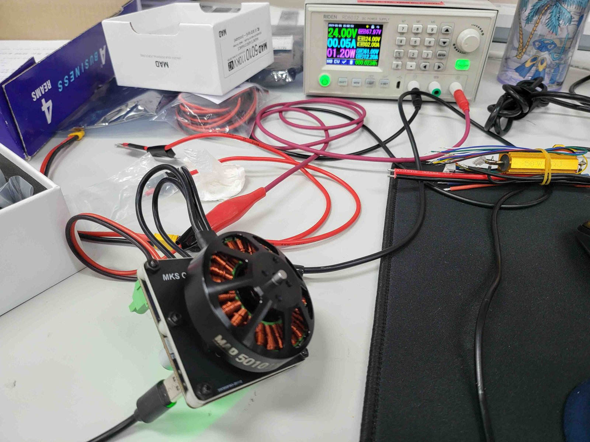
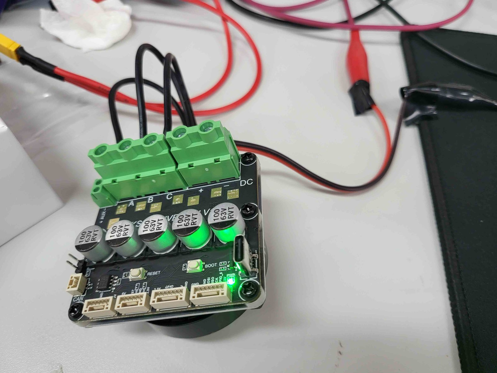

# xdrive-mini-fw-instant-start

Modified ODrive v0.5.1 firmware for the **XDrive MINI** (an ODrive v3.6 compatible board by Makerbase/MKS), using the board's built-in **AS5047P** absolute encoder.

With this firmware the drive:

- **skips encoder offset calibration at power-on** and uses the saved encoder offset, and
- **starts from any rotor position** and goes straight into closed-loop control, without jumping.

Based on the MKS firmware from [makerbase-mks/ODrive-MKS](https://github.com/makerbase-mks/ODrive-MKS).

<p>
  
  
</p>

## Repository layout

```
xdrive-mini-fw-instant-start/
├── ODrive_S-fw-v0.5.1/   firmware source (MKS firmware + this modification)
├── xdrive_config.txt     odrivetool configuration used with this firmware
├── images/               photos of the test setup
└── LICENSE               GPL-3.0
```

## The problem

With the stock MKS firmware:

1. **Calibration every boot.** The firmware cleared `encoder.config.pre_calibrated` unless offset calibration had already run in the same power cycle, so the motor had to calibrate on every power-on.
2. **Could only start at position zero.** With calibration skipped, the position estimate started at 0 instead of the real encoder angle, causing a jump or error when entering closed-loop control.

## What changed

All changes are in [`encoder.cpp`](ODrive_S-fw-v0.5.1/Firmware/MotorControl/encoder.cpp), as a single commit on top of the unmodified MKS code.

| Function | Change |
|---|---|
| `check_pre_calibrated()` | Absolute encoders keep `pre_calibrated = True` without re-running offset calibration. |
| `abs_spi_cb()` | Seeds the position estimate with the absolute encoder angle and zero velocity at startup. |
| `abs_spi_start_transaction()` | Skips a cycle when SPI is busy instead of erroring. Sustained failures still raise `ERROR_ABS_SPI_COM_FAIL`. |

## Usage

1. **Flash the firmware.** Download the `.hex` / `.elf` from the [Releases](../../releases) page, or build and flash it yourself (see [Building and flashing](#building-and-flashing)).
2. **Configure with odrivetool** using [`xdrive_config.txt`](xdrive_config.txt). It includes the one-time calibration; after that the drive starts at any position without calibrating.

## Building and flashing

Requirements (Linux / WSL): `arm-none-eabi-gcc`, `tup`, `python3`, `openocd`, and an **ST-Link V2** connected to the board's SWD pins ([MKS instruction video](https://youtu.be/k9cBYpxeytk)).

```bash
cd ODrive_S-fw-v0.5.1/Firmware
sudo ln -sf $(which python3) /usr/bin/python   # one-time: build scripts call `python`
rm -rf .tup build autogen                      # clean build
tup init
make          # build: output in build/ODriveFirmware.hex / .elf
make flash    # build and flash through the ST-Link V2
```

## Hardware tested

XDrive MINI with motors [MAD M6C12 150KV](https://store.mad-motor.com/products/mad-m6c12-eee-brushless-motor-for-the-long-flight-time-multirotor-hexacopter-octopter) and [MAD 5010 110KV](https://mad-motor.com/products/mad-components-5010-eee?VariantsId=11308).

## Credits and license

- Original firmware: [ODrive Robotics](https://github.com/odriverobotics/ODrive) (MIT, see [`ODrive_S-fw-v0.5.1/LICENSE.md`](ODrive_S-fw-v0.5.1/LICENSE.md))
- MKS board port: [Makerbase (MKS)](https://github.com/makerbase-mks/ODrive-MKS) (GPL-3.0)
- Instant-start modification: Seunghoon Kang, 2026

Distributed under the **GNU GPL v3.0** (see [`LICENSE`](LICENSE)). Provided as-is, without warranty. Make sure your mechanism is safe to move before testing.
